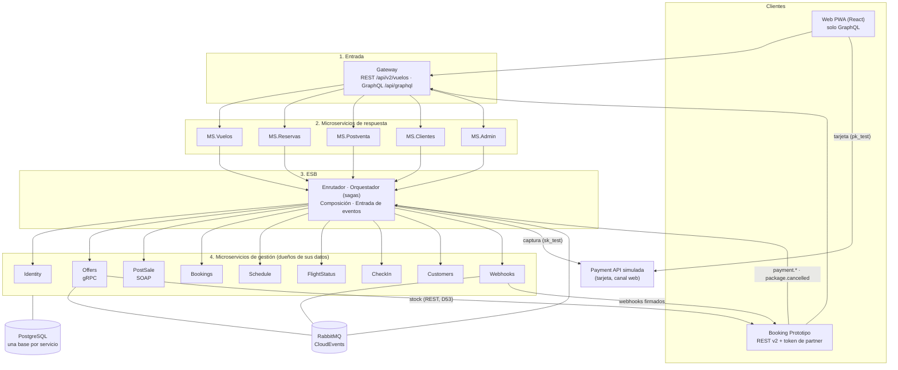
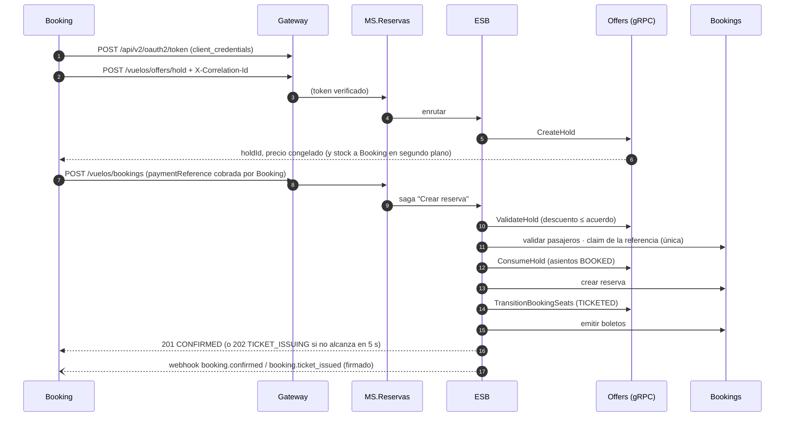
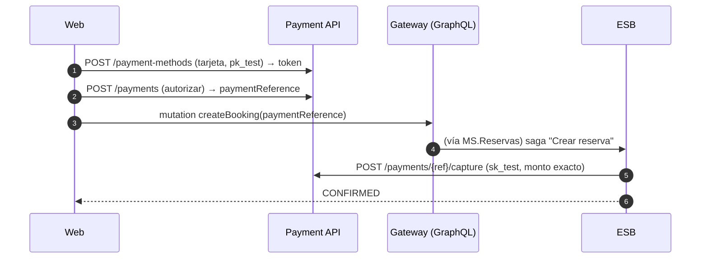
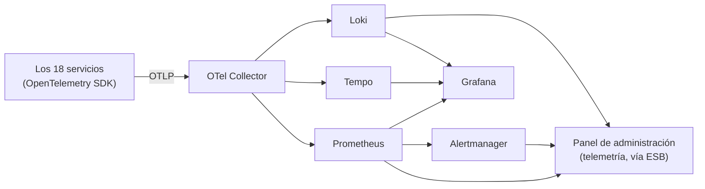
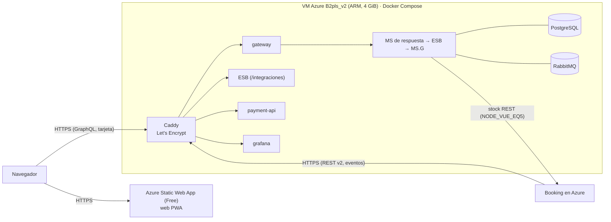

# ARQUITECTURA — EcoAirlines v2 (microservicios)

Documento técnico de la versión 2 (Reto 2): componentes, protocolos, flujos, datos, seguridad, observabilidad y despliegue.
Estado al **03/11/2026** (fase V2.21). Los diagramas están en **Mermaid** (GitHub y VS Code los dibujan).

- **Por qué** se tomó cada decisión: `PLAN/PLAN.md` §7 (D1–D53). **Qué** se hizo en cada fase: `CAMBIOS.md`.
- Eventos: `EVENTOS.md`. Nube: `DESPLIEGUE_AZURE.md`. Dudas con Booking: `HALLAZGOS.md` (serie BKG).
- La versión 1 (monolito en 4 capas) se retiró en V2.21; su documentación está en `historico/reto1/` y su código en el commit `7cdd384`.

**En línea:**

| Qué | URL |
|-----|-----|
| Web (PWA) | https://nice-hill-090e19c10.1.azurestaticapps.net |
| API del contrato v2 (Booking) | https://ecoairlines-reto2.northcentralus.cloudapp.azure.com/api/v2/vuelos/... |
| Swagger del contrato v2 | https://ecoairlines-reto2.northcentralus.cloudapp.azure.com/api/docs/ |
| Grafana (con contraseña) | https://ecoairlines-reto2.northcentralus.cloudapp.azure.com/grafana/ |

> La VM se apaga a las 23:00 de Ecuador para cuidar el crédito: si la API no responde, ver `DESPLIEGUE_AZURE.md` §5.

---

## 1. Vista general



**Reglas que verifica `tests/arquitectura-v2/arquitectura.spec.ts`:**
- Un MS.G **nunca** llama a otro MS.G: solo el ESB los coordina.
- Los MS de respuesta solo llaman al ESB; el gateway solo a los MS de respuesta.
- Solo **Offers** (stock), **Webhooks** (eventos salientes) y el **ESB** (eventos entrantes) hablan con Booking. Ninguna
  operación de un cliente espera a Booking: si no responde, se reintenta después.

---

## 2. Componentes

Puertos locales (`infra/docker-compose.yml`, todos en `127.0.0.1`); dentro de la red de Docker cada servicio escucha en `8080`.

### 2.1 Entrada

| Componente | Protocolo | Puerto local | Qué hace |
|------------|-----------|--------------|----------|
| **Gateway** (`services/gateway`) | REST + GraphQL | 8088 | Las **30 operaciones del contrato v2** en `/api/v2/vuelos/*` (la única puerta de Booking), `POST /api/v2/oauth2/token`, Swagger en `/api/docs`, y **GraphQL** en `/api/graphql` (la única puerta de la web, con suscripciones). Verifica el token con la JWKS de Identity y crea el `X-Correlation-Id` si no llega |

### 2.2 Microservicios de respuesta (`services/respuesta`)

| Servicio | Puerto | Operaciones del contrato v2 | Propias (solo por GraphQL) |
|----------|--------|-----------------------------|----------------------------|
| **MS.Vuelos** | 5001 | `search`, `seatmap`, estado de vuelo (`GET`, `PATCH`), operaciones, health, eventos, promociones | — |
| **MS.Reservas** | 5002 | holds, reservas, boletos, asientos, check-in, pases de abordar | asistencia médica |
| **MS.Postventa** | 5003 | maletas, cambio de fecha, cotización y cancelación | — |
| **MS.Clientes** | 5004 | webhooks (suscripciones) | registro, login, perfil |
| **MS.Admin** | 5005 | — | usuarios, partners, precios y promociones, rutas, flota, asistencia, telemetría, indicadores |

Verifican token y scopes, validan la entrada **exacta** al contrato, responden `ProblemDetails` v2, aplican límite de
peticiones y llaman al ESB con **su propio** token de servicio (D44). **El dueño sale del token**: `sub` (web) o
`partner:<client_id>:<X-User-Id>` (Booking), nunca del cuerpo.

### 2.3 ESB (`services/esb`, puerto 4000)

| Pieza | Qué hace |
|-------|----------|
| **Enrutador** | Una petición → un MS.G, sin coordinación (buscar, consultar reserva, perfil…) |
| **Orquestador** | **11 sagas** con compensación y estado en `saga_log`: crear reserva, emitir boletos, pago fallido, cambiar asientos, check-in, cancelar (y combo cancelado), cambiar fecha, agregar maletas, cambiar estado de vuelo, guardar precios y descuento máximo, publicar horario |
| **Composición** | Lecturas de varios MS.G en paralelo: health del nodo (desde caché, < 1 s), operaciones, indicadores, asistencia por vuelo, telemetría |
| **Entrada de eventos** | `POST /integraciones/booking/eventos`: CloudEvents de Booking firmados (HMAC), sin duplicados (`inbound_events`) |
| **Transversal** | Idempotencia (`Idempotency-Key`, 24 h), validador de referencias de pago de Booking, adaptador de la Payment API, traducción de errores gRPC/SOAP a `ProblemDetails` |

Cada saga respeta el **timeout de 5 s de Booking**: si no termina a tiempo, responde `202` con el estado pendiente y termina en
segundo plano (mensaje diferido en RabbitMQ).

### 2.4 Microservicios de gestión (`services/gestion`)

| Servicio | Protocolo | Puerto | Base | Responsabilidad |
|----------|-----------|--------|------|-----------------|
| **Identity** | REST | 4001 | `identity` | Usuarios y rol (CLIENTE, ADMIN), login, JWT RS256 + JWKS, **partners** y `client_credentials`, tokens de servicio |
| **Customers** | REST | 4002 | `customers` | Perfil y asistencia predeterminada |
| **Webhooks** | REST | 4003 | `webhooks` | Suscripciones, entrega CloudEvents firmada con reintentos, historial y feed con cursor |
| **Schedule** | REST | 4004 | `schedule` | Rutas, flota, horario, precios por clase, acuerdo de promociones (≤ 50 %) |
| **FlightStatus** | REST | 4005 | `flight_status` | Estado operativo, transiciones válidas, puerta, demora, historial |
| **Bookings** | REST | 4006 | `bookings` | Reservas (8 estados), pasajeros, boletos y cupones, PNR, asistencia, referencias de pago únicas, reembolsos |
| **CheckIn** | REST | 4007 | `check_in` | Check-in (exige boletos emitidos) y pases de abordar (QR, grupo, puerta) |
| **PostSale** | **SOAP 1.1 (SOA)** | 4008 | `post_sale` | Cotizaciones de cancelación y cambio de fecha, límite de maletas. WSDL en `?wsdl` |
| **Offers** | **gRPC** | 4009 (health) · 50061 | `offers` | Búsqueda, mapa de asientos con estado, holds (TTL 5–30 min), inventario con cambio atómico, precios; **envía el stock a Booking** |

### 2.5 Externos e infraestructura

| Componente | Puerto | Qué es |
|------------|--------|--------|
| **Payment API simulada** (`services/externos/payment-api`) | 4010 | Pasarela con tarjeta para la web: tokenizar → autorizar (navegador) → capturar / anular / reembolsar (ESB) |
| **Booking simulado** (`services/externos/booking-simulado`) | 4090 · 50051 | Solo para pruebas locales: recibe stock (REST y gRPC) y webhooks, y emite `payment.*` y `package.cancelled` |
| PostgreSQL 17 | 5432 | Un servidor, **una base y un usuario por servicio** |
| RabbitMQ | 5672 · 15672 | Bus interno de eventos (CloudEvents) |
| OTel Collector, Prometheus, Alertmanager, Tempo, Loki, Grafana | 4317/4318, 9090, 9093, 3200, 3100, 3001 | Observabilidad (§6) |

---

## 3. Integración de tecnologías (requisito del Reto 2)

| Tecnología | Dónde | Contrato |
|------------|-------|----------|
| **REST + OpenAPI 3** | Contrato v2 de Booking (gateway), MS.G internos, MS de respuesta, ESB, Payment API | `contract/vuelos-openapi-v2.yaml` (del grupo, sin cambios) y `contract/*.openapi.yaml` |
| **gRPC + Protocol Buffers** | ESB → MS.G.Offers | `contract/ms-g-offers.proto` (`ecoairlines.offers.v1`) |
| **SOA: SOAP + WSDL + XSD** | ESB → MS.G.PostSale, con `CorrelationId` en `<soap:Header>` | `contract/ms-g-post-sale.wsdl` + `.xsd` |
| **GraphQL** (con suscripciones) | Web → Gateway | `contract/gateway.graphql` |
| **Mensajería AMQP + CloudEvents 1.0** | Bus interno, webhooks a Booking, eventos de Booking | `contract/events.asyncapi.yaml` |
| **OAuth2 `client_credentials` + JWT RS256 / JWKS** | Booking y servicios internos | `contract/ms-g-identity.openapi.yaml` |
| **PWA** (manifest + service worker) | Web instalable con pases sin conexión | `ecoairlines-web/vite.config.ts` |
| **OpenTelemetry** | Todos los servicios | `infra/otel/collector.yaml` |

Todo el código es **TypeScript** (Node 24, NestJS 12, React 19). Los contratos se escribieron **antes** del código (V2.1).

---

## 4. Flujos principales

### 4.1 Compra de Booking (canal B2B: Booking cobra)



Si un paso falla, la saga **compensa** en orden inverso: libera asientos, libera la referencia y publica `booking.failed`.
Un `Idempotency-Key` repetido devuelve la misma respuesta (`Idempotent-Replayed: true`).

### 4.2 Compra en la web (canal directo: cobra la Payment API)



La tarjeta **nunca** llega a nuestros servicios: solo la `paymentReference`. Si la saga falla antes de capturar, el ESB
**anula** la autorización; si falla después, **reembolsa**.

### 4.3 Cancelación de un vuelo (operaciones)

`PATCH /vuelos/flights/{n}/status` con `CANCELLED` → FlightStatus valida la transición → Offers **cierra la venta** (stock 0, que
llega a Booking) → cada reserva se cancela con `FLIGHT_CANCELLED` (reembolso del 100 %, calculado para Booking y ejecutado para
la web) → `flight.status_changed` a los suscriptores.

---

## 5. Datos

- **Una base de datos por servicio** en el mismo PostgreSQL, cada una con su propio usuario (`infra/postgres/`). Nadie lee la base
  de otro: los datos de otro servicio se piden por su API.
- Documentos JSONB por agregado; sin `DATABASE_URL` cada servicio funciona en memoria (pruebas).
- **Outbox** en el ESB y en Offers: el evento se guarda en la misma transacción que el cambio y un relé lo publica.
- Modelo lógico: `PLAN/modelo-conceptual-v4.png`. Tablas por base: `PLAN/PLAN.md` §4.6.

---

## 6. Observabilidad



- **Un proceso = un `X-Correlation-Id`** que nunca cambia: viaja por HTTP, gRPC (metadata), SOAP (`<soap:Header>`), RabbitMQ
  (`correlation_id` y `correlationid` del CloudEvent) y en el stock y los webhooks a Booking. Cada salto tiene su `X-Request-Id`.
- Una compra de Booking se ve como **una sola traza** que cruza gateway → MS.Reservas → ESB → Offers (gRPC) → Bookings.
- **Alertas** (`infra/observability/prometheus/alerts.yml`): servicio caído, collector sin datos, latencia y errores altos,
  nodo `DOWN` o degradado, cola creciendo, mensajes en la cola de fallidos, stock sin enviar, webhooks agotados.
- Los logs son JSON con `correlation_id`, `request_id` y `trace_id`, y **nunca** contienen tokens, tarjetas ni datos de salud.

---

## 7. Seguridad

| Token | Quién lo usa | Contenido |
|-------|--------------|-----------|
| **Usuario** | Web | `sub`, `role` (CLIENTE o ADMIN) y scopes del rol |
| **Partner** | Booking (`client_credentials`) | `token_use = partner`, scopes del partner (sin `flights:admin`). Solo con este token se lee `X-User-Id` |
| **Servicio** | ESB y MS de respuesta | `token_use = service`; los MS.G solo aceptan el del ESB |

Todos son RS256, firmados por Identity y verificados con su JWKS. Además: recurso ajeno → `404`; contraseñas y secretos con
`scrypt`; secretos de webhooks cifrados; CORS solo para la web publicada; límite de peticiones; introspección de GraphQL
apagada en producción; el dato de **asistencia médica** no sale en webhooks, logs ni trazas.

---

## 8. Despliegue



- **Local:** `npm run infra:up` levanta los 27 contenedores con el mismo `infra/docker-compose.yml`.
- **Nube:** el mismo Compose más `infra/cloud/docker-compose.cloud.yml` (Caddy, producción, reinicio automático) en **una VM**
  de Azure (D48: Container Apps costaba más que el crédito). La web va aparte en una Static Web App gratuita.
- Solo Caddy (80/443) es público; el ESB, los MS, PostgreSQL y RabbitMQ no salen de la VM. SSH solo por 2222 desde una IP.
- Costo: ≈US$0,034/h encendida + ≈US$6/mes de disco e IP. Guía completa: `DESPLIEGUE_AZURE.md`.

---

## 9. Estructura del repositorio

```
contract/            contratos (API-first): v2 del grupo (sin cambios), uno por microservicio, proto, WSDL, GraphQL, AsyncAPI
packages/shared/     librería común: ProblemDetails, tokens/JWKS, correlation ID, CloudEvents, RabbitMQ, OpenTelemetry, tipos del contrato
services/            gateway · respuesta/ (5) · esb · gestion/ (9) · externos/ (payment-api, booking-simulado)
ecoairlines-web/     web React (solo GraphQL) + PWA
infra/               docker-compose, Dockerfile común, PostgreSQL, observabilidad, nube (Caddy, cloud-init)
tests/               arquitectura-v2 (reglas), conformidad-v2 (las 30 operaciones del contrato contra una URL)
scripts/cloud/       desplegar en la VM, generar secretos, publicar el horario
PLAN/                plan, decisiones e imágenes de arquitectura y modelo conceptual (v4)
historico/reto1/     documentación de la versión 1 (monolito)
```
