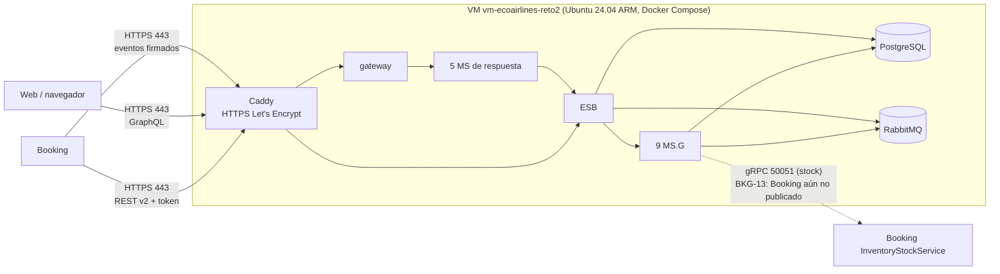

# DESPLIEGUE_AZURE — EcoAirlines en Azure

Guía de lo que está desplegado en Azure, cuánto cuesta y cómo encenderlo, apagarlo, actualizarlo y repararlo. Estado al
**02/11/2026** (fase V2.20, decisiones D48 y D50 de `PLAN/PLAN.md`).

> **Regla de oro:** el límite es el crédito de **Azure for Students: US$90** (eran US$100; US$10 se gastaron en el Reto 1).
> **Nada en Azure detiene el gasto solo:** el presupuesto `presupuestodereto` únicamente envía alertas. Antes de crear
> cualquier recurso con costo hay que estimarlo y aprobarlo, y la VM se apaga (desasigna) cuando no se usa.

---

## 1. Resumen

| Qué | Dónde | Estado | Costo |
|-----|-------|--------|-------|
| **Reto 2** — la ruta de Booking completa (gateway, 5 MS de respuesta, ESB, 9 MS.G, PostgreSQL, RabbitMQ), Payment API y observabilidad | Una VM Linux en **North Central US** | ✅ En uso | ≈US$30,60/mes encendida 24 h · ≈US$6,05/mes apagada |
| **Reto 1** — API del monolito, dev-auth y web | App Service (plan F1) y Static Web App | ⚪ Publicado pero **sin base de datos** (se borró) | US$0 |

**URL pública del Reto 2:** `https://ecoairlines-reto2.northcentralus.cloudapp.azure.com`

| Para qué | Ruta |
|----------|------|
| Contrato de Vuelos v2 (Booking) | `/api/v2/vuelos/...` |
| Token OAuth2 del partner | `/api/v2/oauth2/token` (y el alias `/oauth2/token`, BKG-03) |
| Health del nodo (lo que ve Booking) | `/api/v2/vuelos/health` |
| GraphQL de la web | `/api/graphql` (suscripciones por `wss://.../api/graphql`) |
| Swagger del contrato v2 | `/api/docs/` |
| Eventos de Booking hacia nosotros (`payment.*`, `package.cancelled`) | `POST /integraciones/booking/eventos`, firmado con `X-Webhook-Signature` |
| Payment API simulada (navegador con `pk_test_…`, ESB con `sk_test_…`; D49) | `/payment-api/...` (p. ej. `/payment-api/health`) |
| Health del gateway | `/health` |
| Grafana: tableros, trazas, logs y alertas (usuario `admin`, contraseña `GRAFANA_ADMIN_PASSWORD`) | `/grafana/` |

Todo lo demás responde `404`: el ESB, los MS.G, PostgreSQL y RabbitMQ **no** se publican en Internet.

---

## 2. Arquitectura desplegada



- **Una sola VM** con el mismo `infra/docker-compose.yml` que se prueba en local, más el override
  `infra/cloud/docker-compose.cloud.yml` (Caddy, producción, sin el simulador de Booking, reinicio automático).
- **26 contenedores:** caddy, payment-api, gateway, ms-vuelos, ms-reservas, ms-postventa, ms-clientes, ms-admin, esb, ms-g-identity,
  ms-g-schedule, ms-g-offers, ms-g-bookings, ms-g-check-in, ms-g-post-sale, ms-g-flight-status, ms-g-webhooks,
  ms-g-customers, postgres, rabbitmq, otel-collector, prometheus, alertmanager, loki, tempo, grafana. Usan ≈2,2 GiB + ≈0,9 GiB de swap
  de 3,8 GiB (medido el 02/11, poco después de compilar).
- **HTTPS:** Caddy obtiene y renueva solo el certificado de Let's Encrypt (el actual vence el 24/01/2027 y se renueva unos 30
  días antes). Necesita el puerto 80 abierto para renovarlo.
- **Datos:** PostgreSQL y RabbitMQ guardan sus datos en volúmenes de Docker dentro del disco de la VM. **Apagar la VM no
  borra nada**; borrar la VM o su disco, sí.

**Por qué una VM y no Azure Container Apps (D48):** con 1 réplica fija por servicio (D39), Container Apps costaría
US$100–130/mes, más que todo el crédito. La VM cuesta ≈US$30/mes encendida y se puede apagar entre pruebas.

---

## 3. Inventario y costos

### 3.1 Grupo `rg-ecoairlines-reto2` (North Central US) — Reto 2

Precios oficiales de la API pública de precios de Azure (USD, pago por uso, Linux), consultados el 26/10/2026.

| Recurso | Nombre en Azure | Detalle | Cuándo cobra | Costo |
|---------|-----------------|---------|--------------|-------|
| Máquina virtual | `vm-ecoairlines-reto2` | `Standard_B2pls_v2`: 2 vCPU ARM (Ampere), 4 GiB, burstable; Ubuntu 24.04 LTS `24.04.202609040`; usuario `azureuser` | **Solo encendida** (desasignada no cobra) | **US$0,0336/h** ≈ US$24,53/mes 24 h |
| Disco del sistema | `vm-ecoairlines-reto2_OsDisk_1_…` | SSD estándar (E4) 32 GB; tiene el sistema, Docker, las imágenes y los datos | **Siempre**, aun apagada | **US$2,40/mes** |
| IP pública | `vm-ecoairlines-reto2PublicIP` | Estándar, estática: `20.125.198.18` con el nombre `ecoairlines-reto2.northcentralus.cloudapp.azure.com` | **Siempre**, aun apagada | **US$0,005/h** ≈ US$3,65/mes |
| Grupo de seguridad | `vm-ecoairlines-reto2NSG` | Reglas: `allow-http-https` (80 y 443 desde Internet) y `allow-ssh-2222` (2222 solo desde la IP del responsable) | — | Gratis |
| Red virtual y tarjeta | `vm-ecoairlines-reto2VNET`, `vm-ecoairlines-reto2VMNic` | Red privada de la VM | — | Gratis |
| Apagado automático | `shutdown-computevm-vm-ecoairlines-reto2` | Todos los días a las **04:00 UTC = 23:00 de Ecuador**; desasigna la VM | — | Gratis |
| Tráfico de salida | — | Los primeros 100 GB/mes de salida a Internet son gratis; el uso del proyecto es de pocos MB | Por GB sobre 100 GB | ≈US$0 |

### 3.2 Otros grupos

| Grupo | Contenido | Costo |
|-------|-----------|-------|
| `rg-ecoairlines` (Reto 1) | Plan `ASP-rgecoairlines-914d` (**F1, gratis**), apps `ecoairlines-api-gv` y `ecoairlines-auth-gv`, Static Web App `ecoairlines-web` (**Free**) | US$0 |
| `NetworkWatcherRG` | `NetworkWatcher_northcentralus`, lo crea Azure solo al crear una red | US$0 |
| `DefaultResourceGroup-EUS2` | Vacío (lo creó Azure en el Reto 1) | US$0 |

### 3.3 Cuánto dura el crédito

| Uso de la VM | Horas/mes | VM | Disco + IP | **Total/mes** | Con US$90 alcanza para |
|--------------|-----------|----|------------|---------------|------------------------|
| Encendida 24 h, todos los días | 730 | US$24,53 | US$6,05 | **US$30,58** | ≈2,9 meses |
| Hasta las 23:00 (apagado automático), encendida desde las 08:00 | ≈450 | US$15,12 | US$6,05 | **US$21,17** | ≈4,2 meses |
| 8 h en días laborables (pruebas con Booking) | ≈176 | US$5,91 | US$6,05 | **US$11,96** | ≈7,5 meses |
| Apagada todo el mes | 0 | US$0 | US$6,05 | **US$6,05** | ≈14 meses |

**Ahorro hecho el 26/10/2026 en el Reto 1:** plan B1 → F1 (≈US$13/mes) y borrado de su PostgreSQL B1ms (≈US$16/mes):
≈US$29/mes que ya no se gastan.

### 3.4 Ver el gasto y el crédito

- **Crédito restante:** portal de Azure → buscar **"Education"** → *Overview* (muestra el saldo de Azure for Students), o
  <https://www.microsoftazuresponsorships.com/balance>.
- **Gasto del mes:** portal → **Cost Management** → *Cost analysis* (agrupar por *Resource*).
- **Presupuesto con alertas:** portal → Cost Management → *Budgets* → `presupuestodereto` (US$100/mes). Conviene bajarlo a un
  valor más prudente (p. ej. US$25/mes) para que avise antes. **Solo avisa por correo; no apaga nada.**
- Desde la CLI (puede tardar en reflejar el día):

```powershell
az consumption budget list --query "[].{nombre:name, monto:amount, gastado:currentSpend.amount}" -o table
```

---

## 4. Requisitos para operar

1. **Azure CLI** instalada y sesión iniciada:
   ```powershell
   az login                 # abre el navegador; cuenta de la PUCE (Azure for Students)
   az account show -o table # debe decir "Azure for Students"
   ```
   En Git Bash `az` no siempre aparece en el PATH: usar PowerShell, o la ruta completa
   `& "C:\Program Files\Microsoft SDKs\Azure\CLI2\wbin\az.cmd" ...`.
2. **Clave SSH:** `~/.ssh/id_rsa` (la creó `az vm create --generate-ssh-keys`). Sin ella no se entra a la VM: **no borrarla**
   (si se pierde, se reemplaza con `az vm user update -g rg-ecoairlines-reto2 -n vm-ecoairlines-reto2 -u azureuser --ssh-key-value "<nueva clave pública>"`).
3. **El archivo de secretos** `infra/cloud/.env` (ver la sección 8). Solo existe en el equipo del responsable y en la VM.

---

## 5. Encender y apagar

> **Importante:** "apagar" desde Linux (`sudo shutdown`) **sigue cobrando** la VM. Para dejar de pagar hay que
> **desasignarla** (`deallocate`), que es lo que hace el apagado automático y el botón *Detener* del portal.

### 5.1 Desde la CLI (PowerShell)

```powershell
# Ver el estado: "VM running" (cobra) o "VM deallocated" (no cobra la VM)
az vm get-instance-view -g rg-ecoairlines-reto2 -n vm-ecoairlines-reto2 --query "instanceView.statuses[1].displayStatus" -o tsv

# ENCENDER (~1 min). Los 26 contenedores arrancan solos (restart: unless-stopped); el sistema queda listo en ~2-3 min.
# Tras varios días apagada, Ubuntu aplica parches y el sistema responde lento: encenderla al menos 1 h antes de probar con Booking.
az vm start -g rg-ecoairlines-reto2 -n vm-ecoairlines-reto2

# APAGAR Y DESASIGNAR (deja de cobrar la VM; quedan el disco y la IP)
az vm deallocate -g rg-ecoairlines-reto2 -n vm-ecoairlines-reto2

# Reiniciar (si algo quedó colgado)
az vm restart -g rg-ecoairlines-reto2 -n vm-ecoairlines-reto2
```

Después de encender, comprobar que responde:

```bash
curl -s https://ecoairlines-reto2.northcentralus.cloudapp.azure.com/api/v2/vuelos/health
# {"status":"HEALTHY", ...}: listo. "DEGRADED" o 503 durante los primeros minutos es normal (están arrancando).
```

### 5.2 Desde el portal

Portal de Azure → *Máquinas virtuales* → `vm-ecoairlines-reto2` → **Iniciar** / **Detener** (Detener desasigna).

### 5.3 Apagado automático

Configurado a las **04:00 UTC (23:00 de Ecuador)**, todos los días. **No enciende la VM**: hay que encenderla a mano.

```powershell
# Cambiar la hora (formato HHMM en UTC; Ecuador = UTC-5). Ej.: 20:00 de Ecuador = 0100
az vm auto-shutdown -g rg-ecoairlines-reto2 -n vm-ecoairlines-reto2 --time 0100
# Quitarlo (p. ej. si Booking necesita el nodo toda la noche; recordar apagarla después)
az vm auto-shutdown -g rg-ecoairlines-reto2 -n vm-ecoairlines-reto2 --off
```

### 5.4 Apagar o encender un solo servicio (dentro de la VM)

```bash
ssh -p 2222 azureuser@ecoairlines-reto2.northcentralus.cloudapp.azure.com
cd ~/reto2/infra
alias dc='docker compose -f docker-compose.yml -f cloud/docker-compose.cloud.yml --env-file cloud/.env'
dc ps                      # estado de los 26 contenedores
dc restart ms-g-offers     # reiniciar uno
dc stop ms-admin           # detener uno (no ahorra dinero: la VM cobra igual)
dc up -d                   # volver a levantar todo lo que falte
```

---

## 6. Acceso SSH

- **Puerto 2222**, no 22: la red de la PUCE bloquea el SSH de salida al 22. La VM escucha en los dos, pero en el NSG solo
  está abierto el **2222** y solo desde **una IP** (la del responsable al desplegar: `157.100.143.28`).

```bash
ssh -p 2222 azureuser@ecoairlines-reto2.northcentralus.cloudapp.azure.com
```

- **Si da "Connection timed out":** casi siempre cambió tu IP pública (otra red, otra ubicación). Actualizar la regla:

```powershell
$ip = Invoke-RestMethod https://api.ipify.org
az network nsg rule update -g rg-ecoairlines-reto2 --nsg-name vm-ecoairlines-reto2NSG -n allow-ssh-2222 --source-address-prefixes $ip
```

- **Sin SSH** (p. ej. desde una red que bloquea todo): `az vm run-command invoke` ejecuta comandos dentro de la VM:

```powershell
az vm run-command invoke -g rg-ecoairlines-reto2 -n vm-ecoairlines-reto2 --command-id RunShellScript --scripts "cd /home/azureuser/reto2/infra && docker compose -f docker-compose.yml -f cloud/docker-compose.cloud.yml --env-file cloud/.env ps" --query "value[0].message" -o tsv
```

- **Nunca** abrir el SSH a cualquier origen (`*`).

---

## 7. Desplegar y actualizar

Todo se hace desde la raíz del repositorio, en **Git Bash**, con la VM encendida.

### 7.1 Desplegar o actualizar el código

```bash
bash scripts/cloud/desplegar.sh ecoairlines-reto2.northcentralus.cloudapp.azure.com
```

Qué hace (`scripts/cloud/desplegar.sh`):
1. Empaqueta solo lo que necesitan las imágenes (`package.json`, `package-lock.json`, `tsconfig.base.json`, `packages/`,
   `services/`, `contract/`, `infra/`), **sin** `node_modules`, `dist` ni archivos `.env` (≈700 KB).
2. Lo copia a la VM por SSH (puerto 2222, cambiable con `SSH_PORT`) junto con `infra/cloud/.env`, que viaja aparte.
3. En la VM compila las imágenes **de a 2** (para no agotar los 4 GiB) y levanta todo con el override de la nube.
4. Recrea Caddy, el Collector y la observabilidad (su configuración se monta como archivo y, si no, seguirían con la anterior).
5. Muestra el estado de los contenedores.

La primera compilación tarda ~15 min; después, Docker reutiliza las capas y solo recompila lo que cambió. Durante la
actualización el servicio puede responder `503` unos segundos.

### 7.2 Publicar el horario y los precios

En una base nueva no hay vuelos hasta publicar el horario (saga "Publicar horario" del ESB). Se ejecuta **dentro** de la VM,
con el token de servicio del ESB y el administrador como actor (nada de eso sale a Internet):

```bash
bash scripts/cloud/publicar-horario.sh ecoairlines-reto2.northcentralus.cloudapp.azure.com
# Publicar horario: 200 {"published":{... "added":368 ...},"flights":368}
```

Es idempotente: repetirlo no duplica vuelos. Se publicó el 26/10/2026 (368 vuelos).

### 7.3 Registros (logs)

```bash
ssh -p 2222 azureuser@ecoairlines-reto2.northcentralus.cloudapp.azure.com
cd ~/reto2/infra && alias dc='docker compose -f docker-compose.yml -f cloud/docker-compose.cloud.yml --env-file cloud/.env'
dc logs -f --tail 100 gateway          # un servicio en vivo
dc logs --since 30m esb | grep -i error
dc logs caddy | grep -i certificate    # renovación del certificado
```

Los registros son JSON, con `correlation_id` y `request_id`, y **nunca** contienen tokens, datos de pago ni de salud.

### 7.4 Espacio en disco

Cada compilación deja caché de Docker. Si el disco pasa del 80 %:

```bash
df -h /                       # uso del disco
docker builder prune -af      # libera la caché de compilación (el 26/10 liberó 6,3 GB)
docker image prune -f         # imágenes viejas sin usar
```

**Nunca** `docker volume prune` ni `docker compose down -v`: borran las bases de datos.

### 7.5 Respaldo de las bases (opcional)

```bash
ssh -p 2222 azureuser@ecoairlines-reto2.northcentralus.cloudapp.azure.com \
  'cd ~/reto2/infra && docker compose -f docker-compose.yml -f cloud/docker-compose.cloud.yml --env-file cloud/.env exec -T postgres pg_dumpall -U ecoairlines_admin' > respaldo-reto2-$(date +%F).sql
```

Guardarlo **fuera del repositorio** (contiene datos de usuarios).

---

## 8. Secretos y entrega a Booking

`infra/cloud/.env` se generó **una sola vez** con:

```bash
node scripts/cloud/generar-env.mjs --domain ecoairlines-reto2.northcentralus.cloudapp.azure.com
```

| Variable | Para qué |
|----------|----------|
| `DOMAIN` | Nombre del certificado HTTPS |
| `BOOKING_GRPC_ADDRESS` | A dónde envía Offers el stock (`booking.epn.edu.ec:50051`, ver BKG-13) |
| `POSTGRES_ADMIN_PASSWORD`, `PG_PASSWORD_*` | Contraseña de PostgreSQL y de cada base (una por servicio) |
| `RABBITMQ_PASSWORD` | RabbitMQ |
| `IDENTITY_PRIVATE_KEY` | Clave RSA con la que Identity firma TODOS los tokens |
| `ADMIN_PASSWORD` | Contraseña de `admin@ecoairlines.test` |
| `BOOKING_CLIENT_SECRET` | `client_secret` del partner `BOOKING_PROTOTIPO` |
| `ESB_CLIENT_SECRET`, `MS_*_CLIENT_SECRET` | Tokens de servicio internos (D41, D44) |
| `WEBHOOKS_ENCRYPTION_KEY` | Cifra los secretos de los webhooks |
| `AIRLINE_EVENTS_SECRET` | Firma (HMAC) de los eventos que nos envía Booking |
| `PAYMENT_PUBLISHABLE_KEY`, `PAYMENT_SECRET_KEY` | Claves de la Payment API: la pública va en el navegador; la secreta solo la usa el ESB (agregadas el 26/10 con V2.15) |

- **No se sube al repositorio** (`.gitignore`) y el script **no lo sobrescribe**: cambiar la clave de Identity invalidaría todos
  los tokens, y cambiar las contraseñas de PostgreSQL dejaría las bases inaccesibles. Guardar una copia en un lugar privado.
- **Qué se entrega a Booking, solo por un canal privado:**
  - URL base: `https://ecoairlines-reto2.northcentralus.cloudapp.azure.com/api/v2`
  - `client_id`: `BOOKING_PROTOTIPO` y `client_secret`: el valor de `BOOKING_CLIENT_SECRET`
  - URL de sus eventos: `https://ecoairlines-reto2.northcentralus.cloudapp.azure.com/integraciones/booking/eventos` y el
    secreto de la firma `AIRLINE_EVENTS_SECRET` (cabecera `X-Webhook-Signature: sha256=<HMAC-SHA256 del cuerpo>`)
- **Cambiar un valor** (p. ej. la dirección gRPC de Booking cuando respondan BKG-13): editar `infra/cloud/.env` en el equipo
  local, volver a ejecutar `desplegar.sh` (Compose recrea solo los contenedores afectados).

---

## 9. Problemas frecuentes

| Síntoma | Causa probable | Solución |
|---------|----------------|----------|
| La URL no responde | La VM está desasignada (apagado automático) | `az vm start ...` y esperar 2–3 min |
| SSH: `Connection timed out` | Cambió tu IP pública, o se usó el puerto 22 | Puerto 2222; actualizar la regla del NSG (sección 6) |
| `503` / health `DEGRADED` justo al encender | Los contenedores todavía arrancan | Esperar; `dc ps` debe mostrar `(healthy)` |
| Certificado inválido | Caddy no pudo renovar (puerto 80 cerrado o la VM apagada muchos días) | Verificar la regla `allow-http-https`; `dc restart caddy`; ver `dc logs caddy` |
| `pendingStockPushes` crece en el panel | Booking no es alcanzable (BKG-13) | Normal mientras Booking no publique su gRPC; se envían solos al conectarse |
| Error al compilar (`npm ci ETIMEDOUT`) | Red lenta al descargar paquetes | Volver a ejecutar `desplegar.sh` |
| La VM se queda sin memoria | Demasiadas compilaciones en paralelo | El script compila de a 2; la VM tiene 2 GB de swap |
| Disco lleno | Caché de compilación | `docker builder prune -af` (sección 7.4) |
| `CollectorSinDatos` activa o paneles vacíos | El Collector sigue con una configuración anterior | `dc up -d --no-deps --force-recreate otel-collector` |
| `/vuelos/health` tarda más de 1 s al encender | Parches de Ubuntu (`unattended-upgrades`) tras días apagada | Esperar; `pgrep -a unattended` muestra si sigue activo |

---

## 10. Reto 1 (lo que queda)

| Recurso | Estado | Costo |
|---------|--------|-------|
| Plan `ASP-rgecoairlines-914d` | **F1** (gratis): 60 min de CPU al día, se duerme sin uso | US$0 |
| `ecoairlines-api-gv` (API del monolito) | Publicada, pero **sin base de datos**: falla al arrancar o al consultar | US$0 |
| `ecoairlines-auth-gv` (dev-auth) | Publicada, sin base de datos | US$0 |
| `ecoairlines-web` (Static Web App Free) | Publicada (`nice-hill-090e19c10.1.azurestaticapps.net`); llama a la API que ya no funciona. Será la web del Reto 2 (V2.20) | US$0 |

- **Respaldo de su base:** `Integracion de sistemas/respaldos/reto1-ecoairlines-db-gv-2026-10-26.dump` (formato `pg_dump -Fc`,
  PostgreSQL 18; restauración probada: 13 esquemas, 16 tablas con datos). Para restaurarlo en un PostgreSQL:
  `pg_restore --no-owner --no-acl -d <base> reto1-ecoairlines-db-gv-2026-10-26.dump`.
- Se puede borrar todo el grupo cuando ya no se necesite: `az group delete -n rg-ecoairlines --yes` (irreversible).
- Lo que se borró el 26/10/2026 (a pedido del responsable): la PostgreSQL `ecoairlines-db-gv` y el grupo `rg-vuelos-prod`
  (Azure SQL serverless, plan F1 y una Static Web App).

---

## 11. Restricciones de la suscripción (Azure for Students)

- **Regiones permitidas** (política "Allowed resource deployment regions"): `eastus`, `brazilsouth`, `northcentralus`,
  `chilecentral`, `centralus`. Cualquier otra región falla al crear.
- **Tamaños de VM:** la suscripción no ofrece la B2s en esas regiones. En North Central US hay series B v2
  (`B2pls_v2`, `B2als_v2`, `B2ats_v2`...). Precios Linux por mes (24 h): `B2pls_v2` ARM 4 GiB US$24,53 (la elegida),
  `B2als_v2` AMD 4 GiB US$27,45, `B2ats_v2` AMD 1 GiB US$6,86 (no alcanza: el sistema usa ≈1,6 GiB).
- **Brazil South** es la región más cara (B2s US$49/mes): no usarla para nada nuevo.

---

## 12. Borrar todo el Reto 2

Si hiciera falta liberar todo el gasto (p. ej. al cerrar el curso):

```powershell
az group delete -n rg-ecoairlines-reto2 --yes   # IRREVERSIBLE: borra la VM, el disco (con las bases) y la IP
```

Antes, hacer el respaldo de la sección 7.5. Para volver a desplegar desde cero: crear la VM (sección 13), ejecutar
`desplegar.sh` y `publicar-horario.sh`.

---

## 13. Cómo se creó (para recrearla)

```powershell
az group create -n rg-ecoairlines-reto2 -l northcentralus
az vm create -g rg-ecoairlines-reto2 -n vm-ecoairlines-reto2 -l northcentralus `
  --image Canonical:ubuntu-24_04-lts:server-arm64:24.04.202609040 --size Standard_B2pls_v2 --security-type Standard `
  --admin-username azureuser --generate-ssh-keys `
  --public-ip-sku Standard --public-ip-address-allocation static --public-ip-address-dns-name ecoairlines-reto2 `
  --os-disk-size-gb 32 --storage-sku StandardSSD_LRS --custom-data infra/cloud/cloud-init.yaml --nsg-rule NONE
az network nsg rule create -g rg-ecoairlines-reto2 --nsg-name vm-ecoairlines-reto2NSG -n allow-http-https --priority 1010 `
  --protocol Tcp --destination-port-ranges 80 443 --access Allow --direction Inbound
az network nsg rule create -g rg-ecoairlines-reto2 --nsg-name vm-ecoairlines-reto2NSG -n allow-ssh-2222 --priority 1020 `
  --protocol Tcp --source-address-prefixes <tu IP> --destination-port-ranges 2222 --access Allow --direction Inbound
az vm auto-shutdown -g rg-ecoairlines-reto2 -n vm-ecoairlines-reto2 --time 0400
# SSH también en el 2222 (la red de la PUCE bloquea el 22)
az vm run-command invoke -g rg-ecoairlines-reto2 -n vm-ecoairlines-reto2 --command-id RunShellScript --scripts "mkdir -p /etc/systemd/system/ssh.socket.d && printf '[Socket]\nListenStream=\nListenStream=0.0.0.0:22\nListenStream=[::]:22\nListenStream=0.0.0.0:2222\n' > /etc/systemd/system/ssh.socket.d/puertos.conf && systemctl daemon-reload && systemctl restart ssh.socket"
```

`infra/cloud/cloud-init.yaml` instala Docker y Docker Compose y crea 2 GB de swap en el primer arranque.
