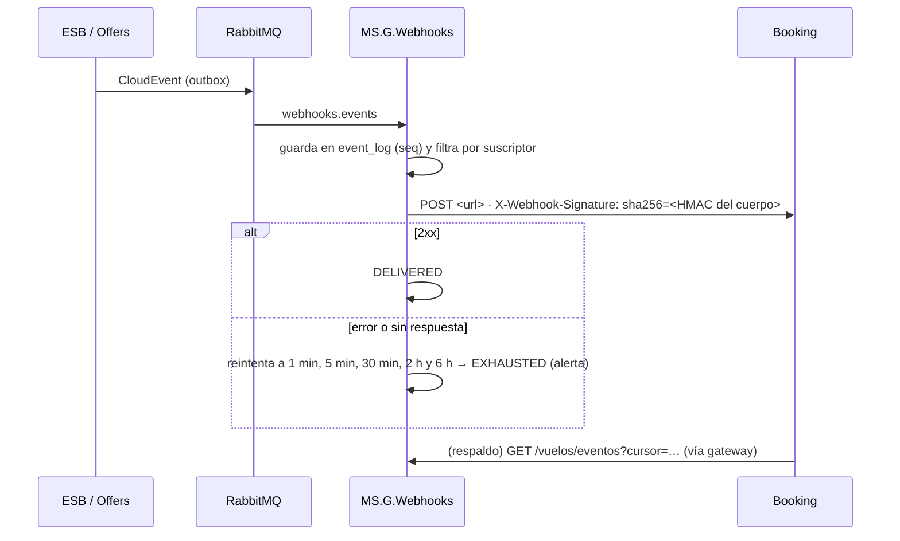

# EVENTOS — Eventos de EcoAirlines v2 (CloudEvents)

Cuando algo importante ocurre (una reserva confirmada, un vuelo cancelado, un precio nuevo), EcoAirlines **publica un evento**
en su bus interno. Los servicios interesados reaccionan sin preguntar, y Booking se entera por **webhooks firmados** o por el
**feed** `GET /vuelos/eventos`, sin hacer *polling* a cada reserva. Estado al **03/11/2026**.

- **Contrato de los eventos:** `contract/events.asyncapi.yaml` (AsyncAPI): internos, salientes a Booking y entrantes de Booking.
- **Contrato del grupo:** `contract/vuelos-openapi-v2.yaml` define los tipos públicos, la firma y el feed.
- Arquitectura general: `ARQUITECTURA.md`. Versión 1 (bus en proceso): `historico/reto1/EVENTOS.md`.

---

## 1. Formato: CloudEvents 1.0

```json
{
  "specversion": "1.0",
  "type": "ec.edu.epn.booking.vuelos.booking.confirmed",
  "source": "/aerolineas/ecoairlines/vuelos",
  "id": "4b7c1f0e-…",
  "time": "2026-11-03T22:19:05.609Z",
  "subject": "<bookingId>",
  "datacontenttype": "application/json",
  "correlationid": "corr-…",
  "data": { "…": "…" }
}
```

- `type` **público** (sale a Booking): `ec.edu.epn.booking.vuelos.<evento>`. **Interno**: `ec.ecoairlines.internal.<evento>`.
- `correlationid` es el **mismo** `X-Correlation-Id` del proceso que lo causó (también en la propiedad AMQP `correlation_id`):
  con él se encuentra todo el proceso en Grafana o en el panel de telemetría.
- Implementación común: `packages/shared/src/cloudevents/`.

---

## 2. El bus: RabbitMQ

| Exchange / cola | Tipo | Para qué |
|-----------------|------|----------|
| `ecoairlines.events` | exchange *topic* | Todos los eventos internos y públicos |
| `webhooks.events` | cola durable | MS.G.Webhooks: guarda cada evento en su historial y lo entrega a los suscriptores |
| `flight-status.schedule` | cola durable | MS.G.FlightStatus: se entera de un horario publicado |
| `esb.deferred` + `esb.deferred.wait.<demora>` | colas con TTL + *dead letter* | Sagas pendientes (pago pendiente, emisión que no terminó en 5 s): reintento diferido |
| `ecoairlines.dlx` | exchange de mensajes fallidos | Lo que no se pudo procesar; alerta `MensajesEnColaDeFallidos` |
| `booking.events` → `ecoairlines.esb.booking-inbound` | bus de Booking (opcional) | Si Booking publicara por AMQP (BKG-01). Hoy vacío: sus eventos llegan por webhook |

**Entrega fiable (*outbox*):** el ESB y Offers guardan el evento en la **misma transacción** que el cambio; un relé lo publica
después. Si RabbitMQ está caído, el evento espera, no se pierde.

---

## 3. Catálogo

**Qué recibe Booking (D40):** de **sus propias reservas**, todo el ciclo; de **los vuelos**, los cambios de estado. De las
reservas hechas en nuestra web no recibe eventos (son datos de nuestros clientes): conoce la disponibilidad por el **stock**,
que incluye las ventas de todos los canales.

| Evento | Produce | Consume | ¿Sale a Booking? |
|--------|---------|---------|:----------------:|
| `hold.created` · `hold.expired` | Offers (outbox) | Webhooks | Sí, de sus holds |
| `booking.confirmed` · `booking.failed` | ESB (saga Crear reserva) | Webhooks | Sí, de sus reservas |
| `booking.ticket_issued` · `booking.ticket_failed` | ESB (saga Emitir boletos) | Webhooks | Sí, de sus reservas |
| `booking.changed` · `booking.baggage_added` · `booking.seat_changed` | ESB (postventa) | Webhooks | Sí, de sus reservas |
| `booking.cancelled` · `booking.checked_in` | ESB | Webhooks | Sí, de sus reservas |
| `flight.status_changed` | ESB (saga Cambiar estado de vuelo) | Webhooks | Sí, todos |
| `schedule.published` | ESB (saga Publicar horario) | FlightStatus | No (interno) |
| `pricing.changed` | ESB (saga Guardar precios) | Webhooks (historial) | No (interno) |
| `user.created` · `user.role_changed` · `user.blocked` · `partner.created` · `partner.secret_rotated` | ESB (administración) | Webhooks (historial) | No (interno) |
| `booking.assistance_requested` | ESB | Webhooks (historial) | **No**: dato de salud |

---

## 4. Hacia Booking: webhooks y feed



- **Suscripción:** Booking registra su URL con `POST /vuelos/webhooks` (scope `flights:webhooks`); el secreto de firma se guarda
  cifrado y nunca se devuelve.
- **Firma:** `X-Webhook-Signature: sha256=<HMAC-SHA256 del cuerpo con el secreto>`; el contenido es `application/cloudevents+json`.
- **Feed:** `GET /vuelos/eventos` con cursor (`seq`): si Booking pierde un webhook, lo recupera de aquí.
- **Estado (03/11):** implementado y probado con el simulador; Booking anunció que sus webhooks se activan «en unos días» (BKG-15).

---

## 5. Desde Booking: eventos entrantes

| Evento de Booking | `type` | Qué hace el ESB |
|-------------------|--------|-----------------|
| `payment.confirmed` | `ec.edu.epn.booking.pagos.payment.confirmed` | Saga **Emitir boletos** (si la reserva quedó en `TICKET_ISSUING`) |
| `payment.failed` | `ec.edu.epn.booking.pagos.payment.failed` | Saga **Pago fallido**: libera asientos, reserva `FAILED`, `booking.failed` |
| `package.cancelled` | `ec.edu.epn.booking.paquetes.package.cancelled` | Saga **Cancelar** con `SAGA_COMPENSATION` (100 % sin penalidad): Booking deshace un combo |

- **Entrada:** `POST https://<dominio>/integraciones/booking/eventos`, firmada con `X-Webhook-Signature` y el secreto
  `AIRLINE_EVENTS_SECRET` (se entrega a Booking por un canal privado).
- **Sin duplicados (D34), en cuatro capas:**
  1. `inbound_events` guarda el `id` de cada CloudEvent: si llega otra vez, responde OK y no lo procesa.
  2. Las sagas son idempotentes (emitir dos veces → `issued: 0`; cancelar dos veces → el resultado anterior).
  3. Cada referencia de pago se usa una sola vez (`payment_records`).
  4. El cambio de estado de cada asiento es atómico en Offers.
- Se procesa con el **mismo `correlationid`** del evento.

---

## 6. Stock hacia Booking (no es un evento del bus)

- Cada cambio de asientos libres (hold, liberación, vencimiento, venta, cancelación, cambio de fecha, cierre de un vuelo) deja
  pendiente, en la misma transacción, el **valor absoluto** de esa cabina (`stock_sync`).
- Offers lo envía en segundo plano: **`POST https://booking-core-api.azurewebsites.net/api/v2/inventory/stock`** (D53) con
  `service_id = NODE_VUE_EQ5`, `item_id = <vuelo>-<cabina>`, `date`, `time_slot` y `available_units`. Vale solo si Booking
  responde `success: true`; si no, reintenta a 1 s, 2 s, 4 s… hasta 60 s. El stock de vuelos que ya salieron no se envía.
- Si llegan varios cambios antes de enviar, sale solo el último. Si un envío se pierde, el siguiente corrige (valor absoluto).
- El gRPC original (`contract/booking-inventory.proto`, D33) queda como alternativa: se usa si se vacía `BOOKING_STOCK_URL`.
- **Estado (03/11):** integrado. Los 736 envíos pendientes desde el 26/10 llegaron sin errores; alerta `StockSinEnviar` si
  algo queda pendiente más de 10 min.

---

## 7. Cómo verlo

| Qué | Dónde |
|-----|-------|
| Historial de eventos y entregas | Web → Administración → Telemetría (o `GET /vuelos/eventos`) |
| Un proceso completo por correlation ID | Panel de telemetría o Grafana → Explore → Loki `{correlation_id="corr-…"}` |
| Colas y mensajes fallidos | Panel de telemetría; en local, la consola de RabbitMQ (`http://localhost:15672`) |
| Stock pendiente | `GET /vuelos/health` (`pendingStockPushes` en el panel) y la alerta `StockSinEnviar` |
| Probar en local sin Booking | `booking-simulado`: `POST http://localhost:4090/simulador/eventos` emite `payment.*` o `package.cancelled` firmados; `GET /simulador/stock` y `GET /simulador/webhooks` muestran lo recibido |
